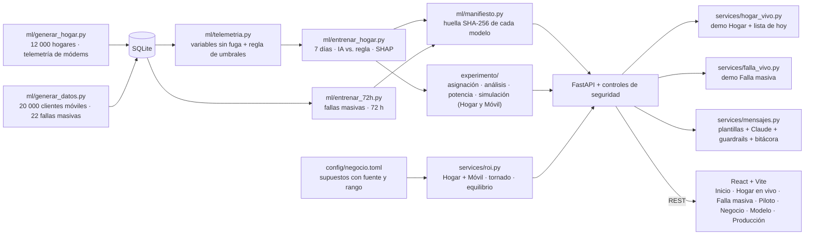

# Arquitectura — Tigo Predice v03

## Prototipo (lo que corre hoy)

- **Sin internet:**
  - el mapa usa un GeoJSON local;
  - sin `ANTHROPIC_API_KEY` funciona en «Modo plantillas»;
  - al arrancar, el modelo LLM se verifica con la Models API.
- **Determinista:** las demos devuelven siempre el mismo escenario, se calculan una vez y no modifican el estado.
- **Una sola fuente de verdad:** `config/negocio.toml` → `roi.py` → la API, `docs/impacto.md` y `docs/cifras.json` (las cifras de los documentos se prueban contra el cálculo).
- **Seguridad:** ver [seguridad_y_privacidad.md](seguridad_y_privacidad.md).
  - **Modo demo:** solo acceso local.
  - **Modo protegido** (con tokens): sesión firmada y revocable, roles, defensa CSRF, límites y bitácora de accesos.
  - **Modelos:** solo se cargan si su huella coincide.

## Producción del piloto (Fase 1)

El diagrama de integración está en [listo_para_produccion.md](listo_para_produccion.md). En resumen:

1. **Ingesta:** CSV diarios del ACS/OLT (telemetría), NOC (cada 15 min), inventario, CRM, call center y órdenes de campo. En producción, la API del ACS cada hora y eventos del NOC en tiempo real.
2. **Hogar:**
   - Cada semana la IA califica a todos los hogares y marca al 2 % con más riesgo, con su explicación (SHAP).
   - Si es remoto, soporte N2 aplica la acción permitida; si es físico, se agenda la visita con el diagnóstico.
3. **Móvil:** detección de afectados (cliente ↔ sitio) y aviso con la causa y la hora del NOC.
4. **Asignación por hash:** `sha256(sal:id)` decide el control (15 %), de forma reproducible y auditable.
5. **Mensaje:** plantilla aprobada o LLM con guardrails:
   - 300 caracteres como máximo y trato de usted;
   - sin horas inventadas, sin datos sensibles y sin enlaces;
   - siempre con opción de AGENTE.

   Queda en la bitácora.
6. **Medición:** visitas por 1,000 hogares marcados (7 días) y llamadas por 1,000 afectados (72 h), tratados vs. control, con IC 95 % y GO/NO-GO por frente.

## Seguridad y ética (resumen)
- **Datos:** solo los mínimos; nunca contenido de comunicaciones, navegación ni dispositivos del cliente. Seudonimización, cifrado y acceso por rol.
- **Modelo de lenguaje:** solo recibe el nombre de pila (saneado), la ciudad y el tipo de situación. El texto del cliente se redacta antes de enviarse.
- **Sesgo:** se monitorea el % marcado vs. la tasa real por tecnología y zona (Hogar) y por zona y segmento (Móvil).
- **Cumplimiento:** el GDPR es el estándar de referencia, porque Honduras aún no tiene ley integral. Evaluación de impacto aprobada antes del primer mensaje.
