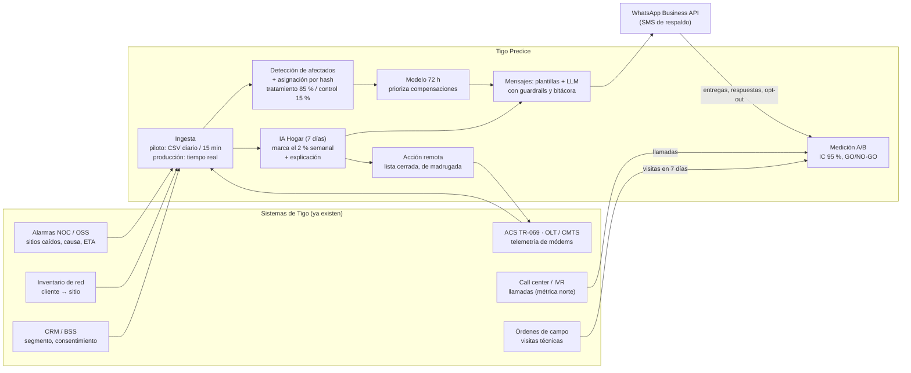

# Listo para producción

> Generado con `python -m backend.app.services.produccion` (misma fuente que la pantalla de la app).
> El piloto arranca con **exportaciones batch (CSV diarios)** antes de integrar en tiempo real: menos costo y menos riesgo. Lo regulatorio se lista como **puntos a validar con Legal de Tigo**; no se citan artículos de ley.

## Integración

| Fuente | Dato | Piloto | Producción |
|---|---|---|---|
| Alarmas del NOC / OSS | Sitios caídos, inicio, causa, hora estimada de solución, restablecimiento | Exportación CSV cada 15 min (o correo del NOC) | Tiempo real (API / eventos) |
| ACS (TR-069) y gestores de OLT / CMTS | Telemetría diaria por módem: señal, errores, reinicios, micro-cortes, latencia, WiFi | Exportación CSV diaria | Cada hora (API del ACS) |
| Órdenes de trabajo de campo | Visitas técnicas con fecha, motivo y código de cierre (métrica norte de Hogar) | CSV diario | Diario |
| Inventario de red | Qué clientes cuelgan de cada sitio/celda y de cada nodo/OLT (hogar) | CSV diario | Diario |
| CRM / BSS | Segmento, plan, antigüedad, canal preferido, consentimiento, opt-out | CSV diario | Diario |
| Call center / IVR | Llamadas por cliente con fecha, hora, motivo y resolución (métrica norte) | CSV diario | Diario o tiempo real |
| WhatsApp Business API | Envío, entrega, lectura, respuestas, opt-outs | Webhook del proveedor | Tiempo real |
| Encuestas CSAT/NPS | Satisfacción de afectados después de la falla | Encuesta corta post-falla | Semanal |

## Conexión de IA

Tigo Predice usa dos tipos de IA. La predictiva detecta el problema antes que el cliente; la generativa redacta el mensaje. La demo web muestra resultados del modelo y plantillas aprobadas, sin conectarse a nada; el prototipo completo conecta ambas en vivo.

| IA | Qué hace | Dónde se conecta | Demo web | Producción |
|---|---|---|---|---|
| IA predictiva (detecta) | Marca cada semana los hogares con más riesgo de llamar o necesitar visita en 7 días, y estima qué afectados de una falla masiva llamarán en 72 horas. Explica cada caso por variables. | Modelos LightGBM calibrados en ml/modelos (se entrenan con ml/entrenar_hogar.py y ml/entrenar_72h.py). El backend los usa en services/hogar_vivo.py y services/falla_vivo.py y verifica la huella SHA-256 de cada modelo antes de cargarlo. | Muestra resultados que el modelo real calculó antes, con datos simulados. No recalcula en vivo. | Califica cada semana con la telemetría real de Tigo (CSV diario en el piloto). |
| IA generativa (redacta) | Redacta los avisos por WhatsApp y responde al cliente en la conversación, con reglas fijas: trato de usted, sin horas inventadas, sin pedir datos sensibles y siempre con la opción de hablar con una persona. | backend/app/llm_client.py con Claude (modelo claude-opus-5-5, configurable con TIGO_LLM_MODEL). Se activa con ANTHROPIC_API_KEY en el archivo .env. Lo usan services/mensajes.py y services/chat.py. Los avisos llevan solo datos mínimos y lo que escribe el cliente se envía sin datos sensibles. Si la IA falla o no hay clave, se usa una plantilla aprobada. | Usa las plantillas aprobadas. La clave de la IA nunca va dentro de la página. | Con acuerdo de procesamiento de datos y retención cero, o con el modelo en la nube corporativa de Tigo. |

### A · Hoy: demo web sin conexión (Implementado)

La demo es un solo archivo con los resultados del modelo y las plantillas aprobadas. Su política de seguridad no le permite conectarse a ningún servidor.

- Funciona sin internet, sin costo por uso y sin riesgo de exponer claves.
- Arriba indica qué IA está activa: resultados del modelo y mensajes con plantillas.
- Para mostrar la IA en vivo se usa el prototipo completo (iniciar_demo.bat con la clave en .env).

### B · Después del concurso: IA generativa en vivo en la web (Diseñado, por implementar)

Un servicio pequeño en el servidor del sitio (por ejemplo, PHP si el plan de Hostinger lo permite, o una función en la nube) guarda la clave fuera de la carpeta pública y solo acepta una tarea: redactar los mensajes de la demo a partir de datos fijos.

- Crear una clave de Anthropic solo para la demo, con límite de gasto mensual.
- Guardarla fuera de la carpeta pública del sitio (nunca en el repositorio ni en la página).
- Publicar el servicio: recibe solo campos fijos (tipo de aviso, causa, hora estimada), nunca texto libre.
- Revisar cada respuesta con las mismas reglas del backend; si no pasa, usar la plantilla aprobada.
- Limitar por visitante y por día, con tiempo máximo de 8 segundos por respuesta.
- Abrir en la página solo la conexión a ese servicio (connect-src 'self') y mostrar «Modo IA».
- Probar: reglas, límites, caída de la IA y que la clave no aparezca en la página ni en el repositorio.

### C · Piloto y producción: backend dentro de Tigo (Plan del piloto)

El backend completo (IA predictiva y generativa) corre en la infraestructura de Tigo, con los datos reales y los controles de la tabla de seguridad: SSO con MFA, gestor de secretos y bitácoras en el SIEM.

- Semanas 0–2: validar el modelo con 3 meses de telemetría real.
- Revisión de Seguridad de la Información, Privacidad y Legal antes del primer mensaje a clientes.
- Clave de la IA en el gestor de secretos de Tigo, nunca en archivos.

## Consentimiento, canal y cumplimiento

- **Canal:** WhatsApp Business API (proveedor oficial de Meta) con plantillas de utilidad aprobadas por Meta, Marca y Legal. SMS como respaldo para quien no usa WhatsApp.
- **Opt-in / opt-out:** Solo clientes con consentimiento para mensajes de servicio. Cualquier respuesta "BAJA" o "NO" registra el opt-out al instante y se respeta para siempre.
- **Frecuencia:** Máximo 2 mensajes por falla (aviso + cierre) y 1 mensaje proactivo por semana fuera de fallas.
- **Contenido:** Guardrails automáticos: 300 caracteres, trato de usted, sin pedir datos sensibles, sin inventar horas de solución y siempre con opción de agente.
- **Telemetría del hogar:** Solo desempeño de la línea y del módem (señal, errores, reinicios, WiFi, nº de dispositivos). Nunca contenido, navegación, DNS ni datos de los dispositivos del cliente. Finalidad única: atender fallas.
- **Acciones remotas:** Lista cerrada (reinicio programado, canal WiFi, firmware certificado), de madrugada, por lotes y con reversión. Las ejecuta el ACS por reglas, nunca el modelo de lenguaje. Validar que el contrato lo permite.
- **Regulación de telecomunicaciones:** Validar con Legal de Tigo los requisitos de CONATEL sobre comunicación de interrupciones y compensaciones.
- **Protección de datos:** Honduras aún no tiene ley integral (proyecto pendiente desde 2018): se aplica el GDPR como estándar, más la Constitución (arts. 76, 100 y 182, habeas data) y la política de privacidad de Millicom. Datos mínimos, seudonimización, cifrado, acceso por rol, bitácoras y evaluación de impacto aprobada antes del piloto.

## Seguridad y privacidad (detalle en docs/seguridad_y_privacidad.md)

| Control | Prototipo | Producción |
|---|---|---|
| Cabeceras de seguridad, CSP y HSTS | Implementado y probado | Igual + WAF |
| Autenticación y sesión | Sesión firmada y revocable, tokens de 24+ caracteres, bloqueo por intentos; probado | SSO corporativo con MFA |
| Roles (mínimo privilegio) | Lectura, operador y auditor (solo el auditor lee bitácoras); probado | Roles desde el SSO |
| CSRF, exposición y abuso | Rechazo por origen; demo solo local; límite de peticiones; parámetros acotados; probado | API gateway |
| Minimización de datos personales | Nombre corto, teléfono enmascarado, sin coordenadas; probado | Esquemas por rol |
| Seguridad del LLM | Sin identificadores; entrada saneada; anti-phishing; sin herramientas; probado | DPA con retención cero o nube corporativa |
| Integridad de los modelos | Huella SHA-256 verificada antes de cargar; probado | Manifiesto firmado con clave del gestor de secretos |
| Bitácoras y retención | Mensajes 90 días; accesos con sesión seudonimizada y sin consulta | SIEM, 1 año |
| Cadena de suministro | requirements.lock; pip-audit y npm audit sin hallazgos; reglas S en el lint | SBOM, escaneo de contenedores y pentest |
| Cifrado y red | Servidor solo en 127.0.0.1 (demo) | TLS 1.3, cifrado con KMS, red privada |

## Matriz de riesgos

| Riesgo | Probabilidad | Impacto | Mitigación |
|---|---|---|---|
| Calidad de datos (cliente ↔ sitio mal mapeado) | Media | Alto | Semanas 0–2: auditar una muestra; usar zona/código postal como respaldo; medir % de avisos a no afectados. |
| La IA no supera a la regla de umbrales con datos reales | Media | Medio | Análisis retrospectivo con 3 meses de telemetría en las semanas 0–2; si no llega a 1.3×, el piloto usa la regla (el producto funciona igual, con menos captura). |
| Una acción remota deja al cliente sin servicio | Baja | Medio | Lista cerrada de acciones, firmware certificado, ventana de madrugada, lotes pequeños y reversión automática; se mide en el grupo tratado. |
| Aviso con hora de solución equivocada | Media | Medio | Solo se da hora si el NOC la tiene; si no, "le avisaremos al restablecer". Mensaje de actualización si la hora cambia. |
| Fatiga de mensajes / opt-outs | Baja | Medio | Máximo 2 mensajes por falla; criterio NO-GO si el opt-out supera 2 %. |
| Costo de compensaciones | Media | Medio | Tope mensual configurable; el modelo prioriza a quién compensar. |
| Privacidad y cumplimiento | Baja | Alto | Evaluación de impacto aprobada antes del piloto; datos mínimos; al LLM solo llega el nombre de pila (texto libre redactado); bitácoras de mensajes y accesos; SSO con MFA y roles. |
| Adopción interna (NOC y call center) | Media | Alto | Patrocinador de CX; enlace del NOC en el equipo; tablero diario compartido. |
| El efecto real es menor al esperado | Media | Medio | Es para lo que existe el grupo control: si no supera el 10 % se detiene (NO-GO) con un costo acotado. |

## Equipo del piloto

| Rol | Dedicación | Responsabilidad |
|---|---|---|
| Patrocinador (Dirección de CX) | 2 h/semana | Decide GO/NO-GO, quita obstáculos |
| Líder del piloto | 50 % | Coordina, mide y reporta |
| Analista/científico de datos | 50 % | Datos, modelo, análisis A/B |
| Enlace del NOC | 10 % | Alarmas, causas y horas estimadas |
| Ingeniería de acceso (Hogar) | 20 % | Telemetría del ACS/OLT, acciones remotas permitidas |
| Soporte remoto nivel 2 | Turno | Atiende la lista diaria de hogares |
| Seguridad y Privacidad | Puntual | Evaluación de impacto, SSO, pentest |
| Canales digitales | 10 % | WhatsApp Business, plantillas |
| Legal | Puntual | Consentimiento, plantillas, compensaciones |
| Finanzas | Puntual | Valida costo por llamada y caso de negocio |

## Plan (12 semanas)

| Semanas | Fase | Actividades |
|---|---|---|
| 0–2 | Preparación | CSV del NOC, ACS/OLT, CRM, call center y campo; análisis retrospectivo (IA vs. regla con 3 meses reales); mapeo cliente↔sitio/nodo; plantillas y evaluación de impacto aprobadas; SSO y pentest. |
| 3–10 | Piloto en vivo | Hogar: la IA marca el 2 % semanal y soporte N2 corrige a distancia. Móvil: avisos y cierres. 15 % de control en ambos; tablero diario. |
| 11–12 | Análisis y decisión | Efecto con IC 95 % (visitas y llamadas), costo real por visita y llamada evitada, GO/NO-GO por frente al comité. |
