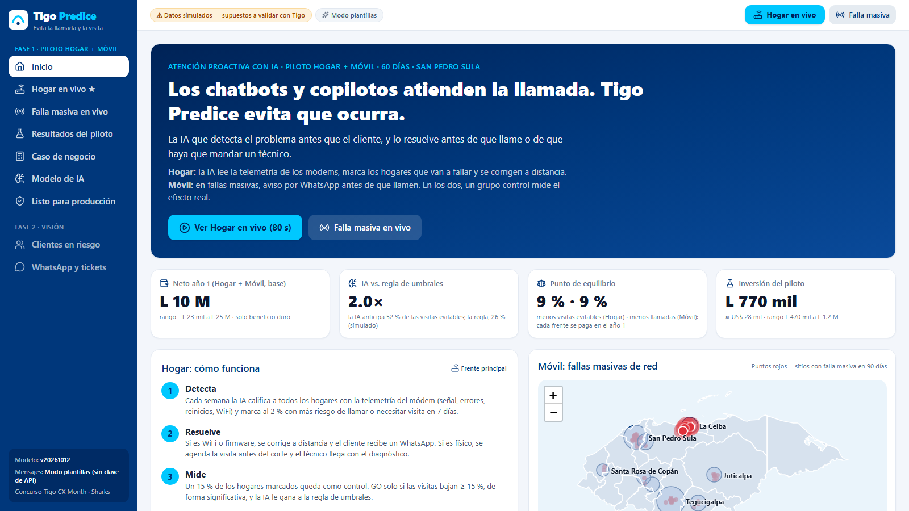
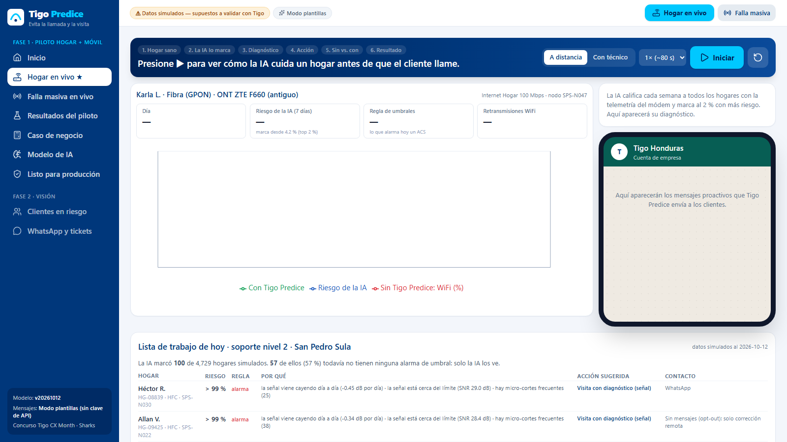
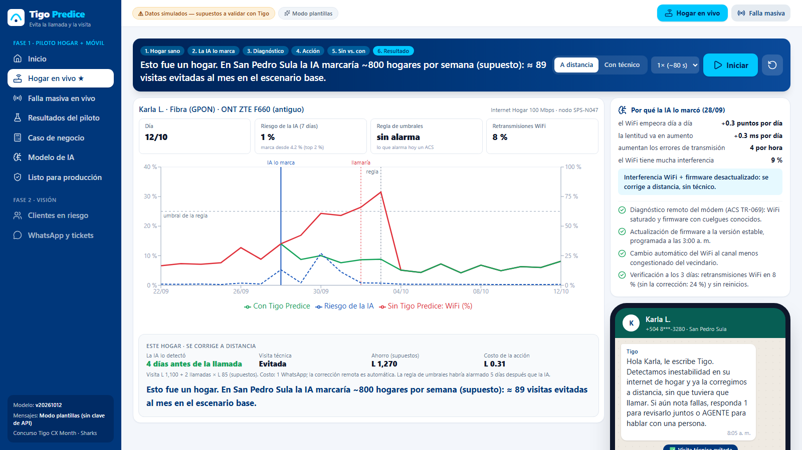
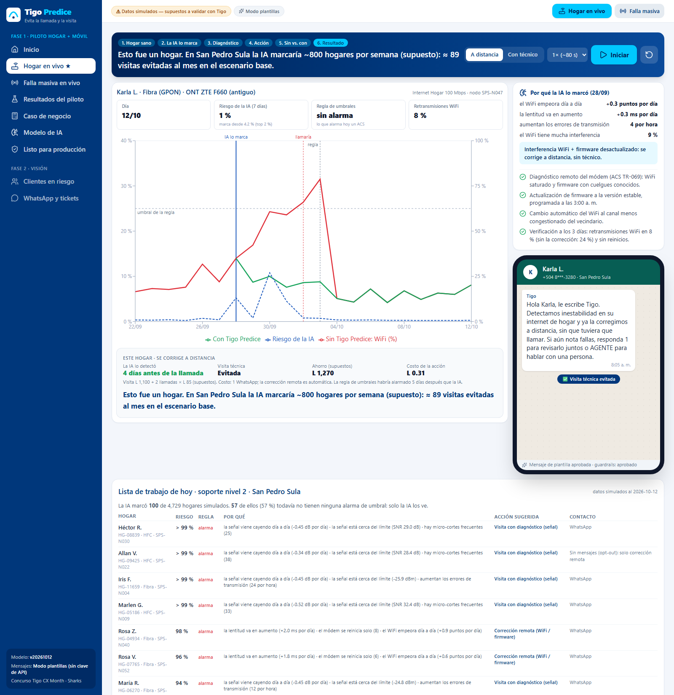
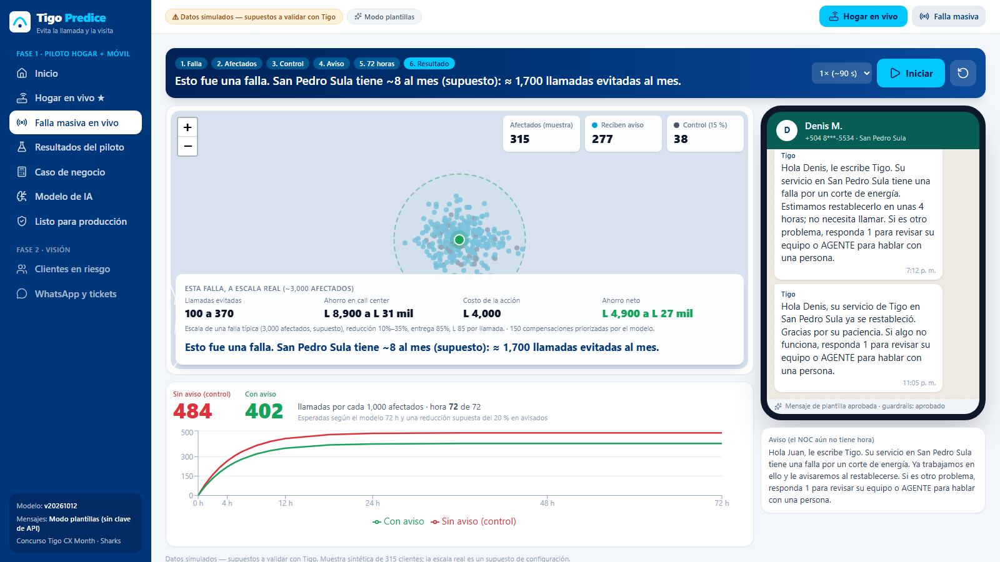
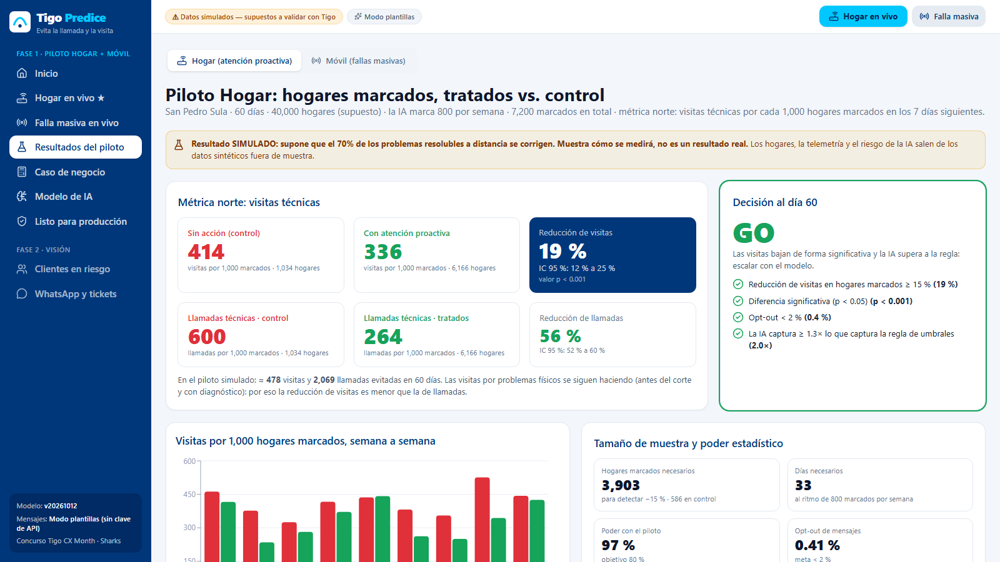
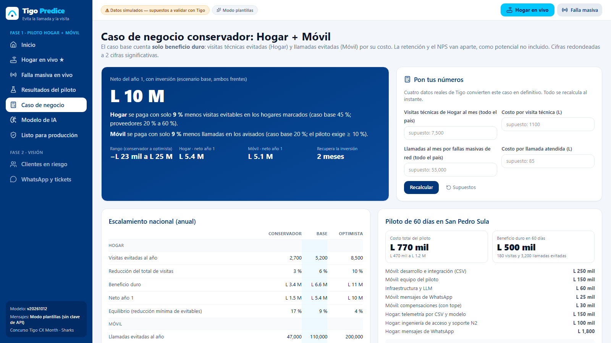
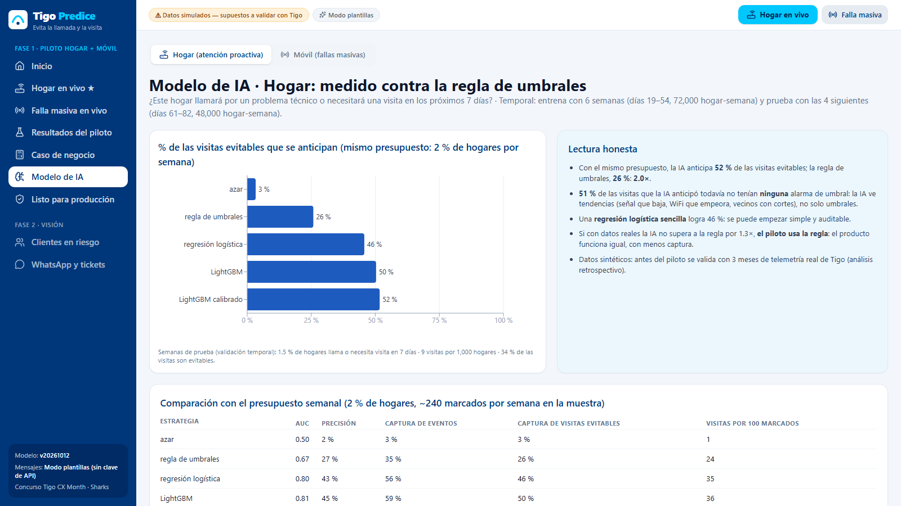
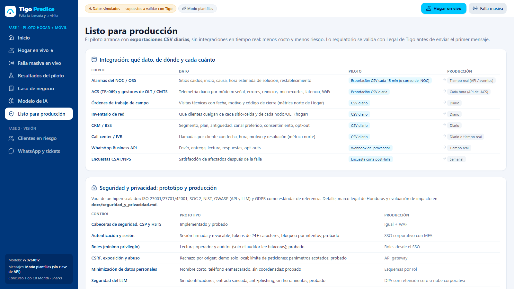
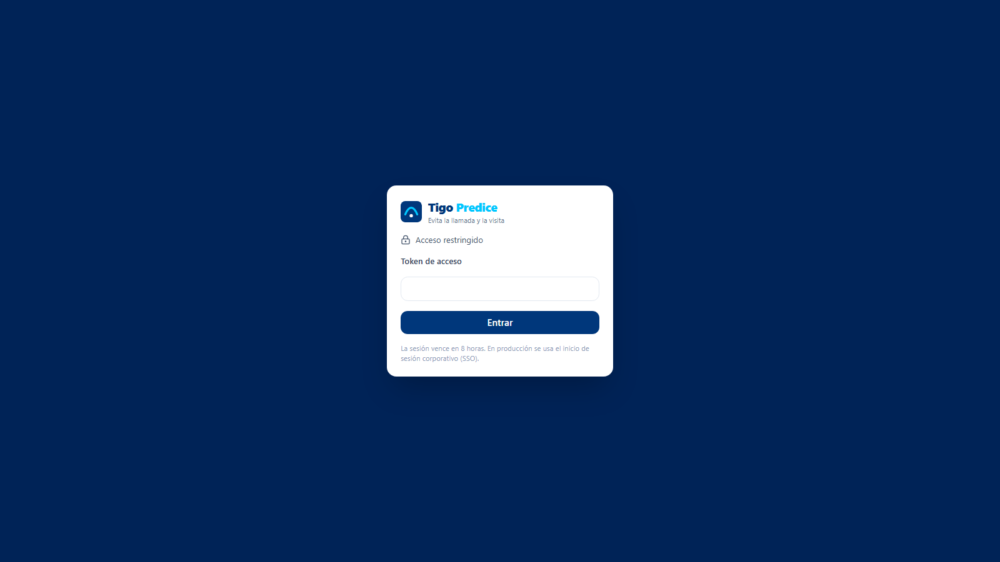

# Guía visual de la demo — Tigo Predice

> Generado con `python docs/entregables/gen_guias.py` (misma fuente que el PDF con capturas anotadas).

## Antes de presentar

1. Doble clic en **iniciar_demo.bat** la noche anterior (la primera vez tarda ~4 minutos; después, 5 segundos).
2. Se abre **http://127.0.0.1:8000**. Arriba debe decir «Datos simulados» y «Modo plantillas» o «Modo IA».
3. Abra **Hogar en vivo**, caso «A distancia», velocidad 1× y presione ↺.
4. Navegador en pantalla completa (F11), zoom 90–100 %, notificaciones apagadas.
5. Deje abiertas en otras pestañas **/hogar?final** y **/falla?final**, y tenga el PDF del pitch a mano.

## Recorrido recomendado (5 minutos)

| Min. | Pantalla | Qué hacer | Frase clave |
|---|---|---|---|
| 0:00 | Inicio | Posicionamiento | «Los chatbots atienden la llamada…» |
| 1:10 | Hogar en vivo | ▶ Iniciar y leer la franja | «La IA lo marca antes que la regla y que la llamada» |
| 2:30 | Modelo de IA | Señalar 52 % vs. 26 % | «Medida contra la regla, no contra nada» |
| 2:50 | Resultados del piloto | GO y −19 % | «Simulado: así se medirá» |
| 3:10 | Falla masiva (opcional) | /falla?final | «El mismo motor en móvil» |
| 3:40 | Caso de negocio | L 10 M y 9 % | «Solo beneficio duro» |
| 4:20 | Listo para producción | Seguridad | «Red team propio, GDPR como vara» |
| 4:40 | Diapositiva final | El pedido | «12 semanas, L 770 mil, GO/NO-GO» |

## Inicio: el mapa de la app

La primera pantalla resume la propuesta. Úsela para abrir la presentación (10 segundos) y saltar a la demo.

1. **Menú.** Todas las pantallas. Fase 1 es el piloto (Hogar + Móvil); Fase 2 es visión y no entra al caso.
2. **Botón «Hogar en vivo».** Atajo a la demo principal desde cualquier pantalla.
3. **Datos simulados.** Recordatorio permanente: todo es simulado o supuesto a validar con Tigo.
4. **Modo plantillas / Modo IA.** Sin clave de API usa plantillas aprobadas; con clave, Claude redacta los mensajes.
5. **Ver Hogar en vivo.** Abre la demo de 80 segundos.
6. **Cifras clave.** Neto año 1, IA vs. regla, punto de equilibrio e inversión del piloto.

## Hogar en vivo ★: antes de iniciar

Deje esta pantalla lista antes de presentar: caso «A distancia», velocidad 1× y la demo reiniciada (↺).

1. **Caso.** «A distancia»: WiFi y firmware, se corrige sin técnico (recomendado). «Con técnico»: la señal de fibra baja y el técnico va una sola vez.
2. **Velocidad.** 1× dura unos 80 s. Use 2× si tiene poco tiempo.
3. **Iniciar ▶.** Arranca la historia; la franja azul narra cada paso.
4. **Reiniciar ↺.** Deja todo limpio para volver a empezar.
5. **Pasos.** Se encienden a medida que avanza: hogar sano → la IA lo marca → diagnóstico → acción → sin vs. con → resultado.
6. **Narración.** Léala en voz alta o parafrasee: es el guion de la demo.
7. **Indicadores.** Día, riesgo que calcula la IA, si la regla de umbrales alarma y la señal principal.
8. **Diagnóstico.** Aquí aparece por qué la IA marcó el hogar y qué acción se tomó.
9. **WhatsApp.** El mensaje que recibe el cliente (plantilla aprobada o IA con guardrails).

## Hogar en vivo ★: el resultado

Así termina la demo. Si algo falla en vivo, abra /hogar?final y explique esta pantalla.

1. **IA lo marca (28/09).** La IA detecta el problema con 13 % de riesgo, dentro del 2 % más alto de la ciudad.
2. **Llamaría (02/10).** Sin Tigo Predice, el cliente habría llamado 4 días después.
3. **Regla (03/10).** Recién aquí la regla de umbrales habría alarmado: después de la llamada.
4. **Riesgo de la IA.** Línea azul punteada: sube antes de que el cliente note nada.
5. **Con Tigo Predice.** Línea verde: el WiFi queda sano tras la corrección remota. Rojo: sin Tigo Predice.
6. **Por qué lo marcó.** Motivos en lenguaje simple (contribuciones SHAP del modelo).
7. **Acciones remotas.** Firmware de madrugada, cambio de canal WiFi y verificación a los 3 días.
8. **WhatsApp.** «Ya la corregimos a distancia, sin que tuviera que llamar», con opción AGENTE.
9. **Resultado.** 4 días antes de la llamada, visita evitada, L 1,270 de ahorro por L 0.31.

## Hogar en vivo ★: la lista de trabajo de hoy

Debajo de la demo: lo que soporte nivel 2 recibiría cada día. Muestra que es un producto operable, no solo una animación.

1. **Resumen.** Hogares marcados hoy en San Pedro Sula y cuántos no tienen ninguna alarma de umbral (solo la IA los ve).
2. **Riesgo.** Probabilidad de llamada o visita en 7 días. Nunca se muestra «100 %».
3. **Regla.** Si la regla de umbrales ya alarmaba o no.
4. **Por qué.** Los tres motivos principales, con su valor.
5. **Acción sugerida.** Corrección remota, visita con diagnóstico o revisar el nodo (posible falla masiva).
6. **Contacto.** Respeta el opt-out: sin mensajes, solo corrección remota.

## Falla masiva en vivo (frente Móvil)

El mismo motor en fallas masivas de red. Opcional en el pitch: muestre /falla?final si sobra tiempo.

1. **Velocidad.** 1× dura unos 90 s.
2. **Iniciar ▶.** Cae un sitio en San Pedro Sula y se dibujan los afectados.
3. **Sitio caído.** Círculo con los clientes afectados (azul: reciben aviso; gris: control).
4. **Grupos.** Afectados, quiénes reciben aviso y el 15 % de control.
5. **Aviso.** Causa en palabras simples y hora del NOC solo si la tiene.
6. **Cierre.** Mensaje cuando vuelve el servicio.
7. **Llamadas por 1,000.** Rojo sin aviso vs. verde con aviso, durante 72 horas.
8. **Escala real.** Llamadas evitadas y ahorro de una falla típica (supuestos).

## Resultados del piloto

Cómo se medirá: tratados vs. control con intervalo de confianza. Es una simulación: dígalo.

1. **Pestañas.** Hogar (por defecto) y Móvil.
2. **Control.** Visitas por 1,000 hogares marcados sin acción.
3. **Tratados.** Visitas por 1,000 con atención proactiva.
4. **Reducción.** −19 % con IC 95 % y valor p.
5. **Decisión.** GO/NO-GO con sus criterios, incluido que la IA le gane a la regla.
6. **Poder estadístico.** Muestra necesaria y poder con el piloto (97 %).

## Caso de negocio y «Pon tus números»

Solo beneficio duro. Si el jurado da un dato real, ingréselo en vivo: es el momento más convincente.

1. **Neto año 1.** Ambos frentes, escenario base, con inversión.
2. **Equilibrio por frente.** Hogar y Móvil se pagan con solo 9 % de reducción.
3. **Visitas al mes.** Escriba el dato real (solo números, sin comas).
4. **Costo por visita.** En lempiras. Lo mismo con llamadas y costo por llamada.
5. **Recalcular.** Todo se recalcula al instante y aparece «usando dato Tigo».
6. **Supuestos.** Vuelve a los valores supuestos.
7. **Escenarios.** Conservador, base y optimista por frente; más abajo, el tornado de sensibilidad.
8. **Piloto.** Costo total del piloto (L 770 mil) y su desglose.

## Modelo de IA: medido contra la regla

La respuesta a «¿por qué no bastan las alarmas?». Señale las dos barras: regla de umbrales vs. IA.

1. **Pestañas.** Hogar (modelo de 7 días) y Móvil (modelo de 72 h).
2. **Regla de umbrales.** Anticipa el 26 % de las visitas evitables.
3. **IA.** Anticipa el 52 %: 2.0× con el mismo presupuesto.
4. **Lectura honesta.** Incluye que una regresión simple casi iguala y que, si no gana, se usa la regla.
5. **Comparación.** AUC, precisión y captura de cada estrategia. Más abajo: calibración, importancia y sesgo.

## Listo para producción

Para la pregunta «¿y esto cómo se implementa y es seguro?».

1. **Integración.** Qué dato, de qué sistema y cada cuánto: CSV en el piloto y tiempo real en producción.
2. **Producción.** Frecuencia objetivo al escalar.
3. **Seguridad y privacidad.** Cada control: estado en el prototipo (probado) y en producción.

## Modo compartido (acceso con token)

Por seguridad, la demo solo atiende a la misma computadora. Para mostrarla en red, defina tokens y la app pide acceso.

1. **Token.** Rol lectura (jurado), operador o auditor, con 24 caracteres o más.
2. **Entrar.** Sesión segura de 8 horas; 5 intentos fallidos bloquean por 15 minutos.
