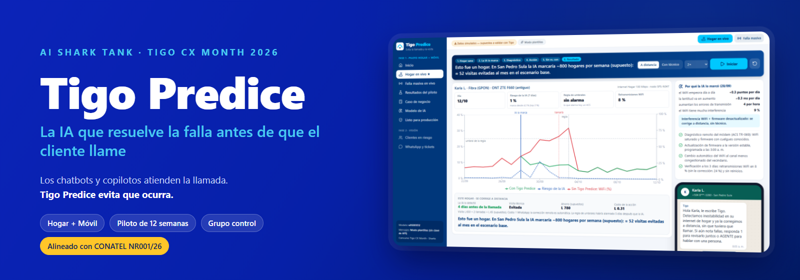
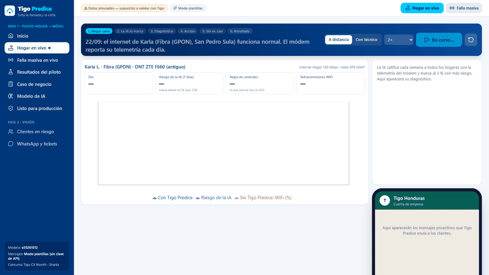
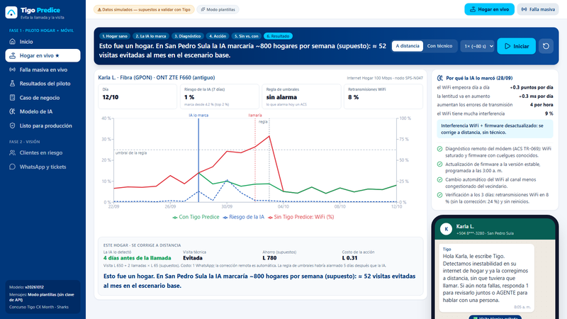
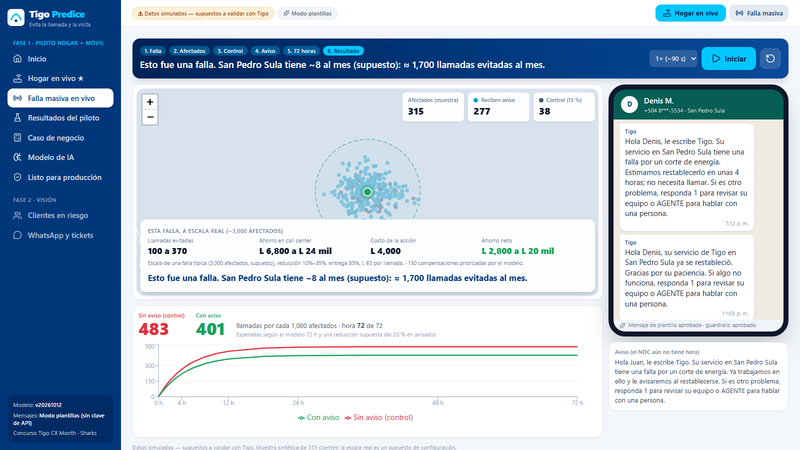
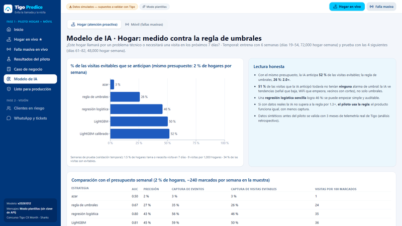
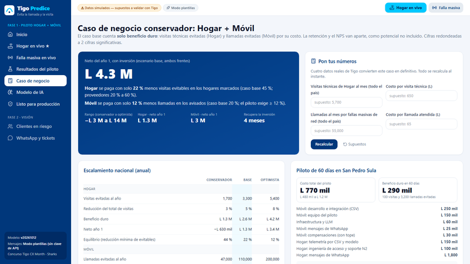

 

-2BB673)

**[Cómo ver la demo](#cómo-ver-la-demo)** · **[Presentación](1_Presentacion/AI_Shark_Tank_Tigo_Predice.pdf)** · **[Resumen de una página](3_Para_el_jurado/OnePager_Tigo_Predice.pdf)** · **[Datos y fuentes](3_Para_el_jurado/Datos_Reales_y_Revision.pdf)** · **[Estrategia y regulación](3_Para_el_jurado/Estrategia_y_Regulacion.pdf)**

> [!IMPORTANT]
> **Datos simulados, base real.** La telemetría, los clientes y los resultados del modelo y del piloto son simulados: muestran cómo se medirá, no un resultado real. La base de clientes (191 mil hogares y 5.0 M de clientes móviles), los precios, el tipo de cambio y los costos de referencia son datos públicos con fuente.

## ¿Qué es Tigo Predice?

**Los chatbots y copilotos atienden la llamada. Tigo Predice evita que ocurra.**

Atención proactiva con IA para Tigo Honduras, en dos frentes con el mismo motor:
- **Hogar:** cada semana la IA lee la telemetría de los módems, marca al 2 % de hogares con más riesgo de fallar y explica por qué. Si es WiFi o firmware, se corrige a distancia; si es físico, el técnico va una sola vez y con el diagnóstico.
- **Móvil:** cuando cae un sitio, aviso en minutos, antes de que el cliente llame. El prototipo simula el canal WhatsApp; en el piloto, el SMS cubre a quien no tenga WhatsApp.

En ambos frentes, un **grupo control aleatorio del 15 %** mide el efecto real.

 Demo «Hogar en vivo»: la IA marca el hogar 4 días antes de la llamada, explica por qué y se corrige a distancia.

## Lo que hace

<table>
<tr>
<td width="50%" valign="top">

### Hogar en vivo
La IA detecta la degradación del módem días antes de que el cliente la note y propone la acción: corrección remota o visita con diagnóstico.

</td>
<td width="50%" valign="top">

### Falla masiva en vivo
Cae un sitio: el aviso llega en minutos y un grupo control mide cuántas llamadas se evitan en 72 horas.

</td>
</tr>
<tr>
<td width="50%" valign="top">

### La IA, medida contra la regla
Con el mismo presupuesto, se compara contra las alarmas por umbral que Tigo ya tiene. Si no gana por 1.3×, se usa la regla.

</td>
<td width="50%" valign="top">

### Caso de negocio conservador
Solo ahorro duro, con costos hondureños, escenarios y punto de equilibrio. En el prototipo completo, «Pon tus números» recalcula con datos de Tigo.

</td>
</tr>
</table>

## Cómo ver la demo

> [!NOTE]
> GitHub no ejecuta archivos HTML: si abre `Demo_Tigo_Predice.html` aquí, verá su código. La demo se abre en su computadora.

1. **Descargue el archivo.** Abra [`2_Demo/Demo_Tigo_Predice.html`](2_Demo/Demo_Tigo_Predice.html) y use el botón **Download raw file**, o descargue todo el repositorio con **Code → Download ZIP** y descomprímalo.
2. **Ábralo con doble clic.** Se abre en el navegador, sin internet y sin instalar nada. Probado en Windows 11 con Microsoft Edge, incluso sin conexión a la red.
3. Entre a **Hogar en vivo ★** y presione **▶ Iniciar**. La historia dura unos 80 segundos. Explore también **Falla masiva en vivo**, **Resultados del piloto** y **Caso de negocio**.

## Cifras clave (escenario base)

| Indicador | Valor |
|---|---|
| **Neto del año 1** | **L 4.3 M**, rango −L 3 M a L 14 M · solo ahorro duro |
| **Punto de equilibrio** | Móvil se paga con 12 % menos llamadas · Hogar, con 22 % menos visitas evitables |
| **IA vs. regla de umbrales** | 52 % vs. 26 % de las visitas evitables anticipadas (2.0×, datos simulados) |
| **Piloto** | 12 semanas en San Pedro Sula · **L 770 mil** (≈ US$ 28 mil) · GO / NO-GO por frente |
| **Costos de referencia** | Visita L 650 · llamada L 65 · WhatsApp L 0.31 por mensaje |

## Por qué ahora

- **Lo prioriza Millicom en 2026:** mejor servicio, eficiencia, flujo de caja y crecer en valor protegiendo el hogar y a los clientes convergentes.
- **Lo exige CONATEL:** el Reglamento de Protección al Usuario NR001/26 (La Gaceta, 28-feb-2026) obliga a avisar a tiempo de averías e interrupciones y a compensar automáticamente las horas sin servicio, con un registro de la duración y las zonas de cada falla. El prototipo ya genera el aviso; el registro para la compensación se construye en el piloto con los datos del NOC.

## Contenido

| Carpeta | Qué tiene |
|---|---|
| [`1_Presentacion`](1_Presentacion) | Presentación para el concurso (12 diapositivas, con guion en las notas), en PowerPoint y PDF |
| [`2_Demo`](2_Demo) | La demo en un solo archivo HTML: se descarga y se abre con doble clic, sin servidor ni internet |
| [`3_Para_el_jurado`](3_Para_el_jurado) | Resumen de una página, propuesta completa, datos reales con fuentes, y estrategia y regulación |
| [`4_Preparacion_del_pitch`](4_Preparacion_del_pitch) | Elevator pitch de 2 minutos, 38 preguntas probables del jurado, guía visual de la demo y presentación extendida |
| [`5_Envio`](5_Envio) | Texto del correo de postulación |
| [`6_Prototipo_completo/tigo-predice`](6_Prototipo_completo/tigo-predice) | Código del prototipo: modelos de IA, API, interfaz, experimento del piloto, caso de negocio y pruebas |
| [`_referencias`](_referencias) | Afiche del concurso |

<b>Prototipo completo: cómo ejecutarlo</b>

 

Probado en Windows 11 con Python 3.15 y Node 24: doble clic en `6_Prototipo_completo/tigo-predice/iniciar_demo.bat` y abrir http://127.0.0.1:8000. La primera vez instala las versiones fijadas, genera los datos, entrena los modelos, registra su huella SHA-256 y compila la interfaz (unos 4 minutos); después arranca en segundos.

Si el **Control inteligente de aplicaciones** de Windows está activo, puede bloquear librerías científicas sin firma (como scikit-learn) y el prototipo completo no arrancará. La demo de `2_Demo` no tiene ese problema.

- **Stack:** Python (FastAPI, LightGBM con calibración isotónica y explicaciones SHAP, SQLite) y React con Vite, TypeScript, Tailwind y Recharts.
- **Pruebas:** 230 de Python (última ejecución completa: 22-oct-2026) y 7 de la interfaz, más análisis estático con reglas de seguridad y auditoría de dependencias sin vulnerabilidades conocidas.
- **Reproducible:** el pipeline completo regenera los mismos datos, modelos y cifras desde cero.

Detalles en el [README del prototipo](6_Prototipo_completo/tigo-predice/README.md).

<b>Seguridad y privacidad</b>

 

- **Marcos de referencia:** GDPR (Honduras aún no tiene ley integral de datos personales), ISO 27001/27701/42001, SOC 2, NIST CSF y AI RMF, OWASP ASVS, API y LLM, y MITRE ATLAS.
- **Datos mínimos:** solo el desempeño del módem y de la línea; nunca contenido, navegación ni los dispositivos del cliente.
- **Controles:** sesión firmada (HMAC) y revocable, roles, protección CSRF, cabeceras de seguridad, bitácoras seudonimizadas y huella SHA-256 de cada modelo verificada antes de cargarlo.
- **Estándares:** mapeo al OWASP Top 10:2025, accesibilidad WCAG 2.2 AA sin infracciones automáticas (axe-core), SBOM CycloneDX y política de seguridad ([`SECURITY.md`](SECURITY.md)). Detalle y pendientes en [`docs/estandares_y_calidad.md`](6_Prototipo_completo/tigo-predice/docs/estandares_y_calidad.md).
- **Red team propio:** 12 ataques probados y corregidos, cada uno con su prueba automática.

Detalle en [`docs/seguridad_y_privacidad.md`](6_Prototipo_completo/tigo-predice/docs/seguridad_y_privacidad.md).

<b>Qué es real y qué es supuesto</b>

 

- **Real (público):** base de clientes de Tigo Honduras (Millicom, Form 20-F 2025), precios de los planes, tipo de cambio del BCH, tarifas de WhatsApp Business, costos de centros de contacto en Honduras y el reglamento NR001/26 de CONATEL.
- **Supuesto, a validar con Tigo:** visitas técnicas al mes, porcentaje de visitas evitables, costo real por visita y por llamada, y el efecto de los avisos.
- **Simulado:** la telemetría, los clientes y los resultados del modelo y del piloto.

Fuentes completas en [`3_Para_el_jurado/Datos_Reales_y_Revision.pdf`](3_Para_el_jurado/Datos_Reales_y_Revision.pdf).

## Autoría

**Sandra Jimenez** · Asistente de Experiencia B2B · Tigo Honduras · [sandra.jimenez@tigo.com.hn](mailto:sandra.jimenez@tigo.com.hn)
